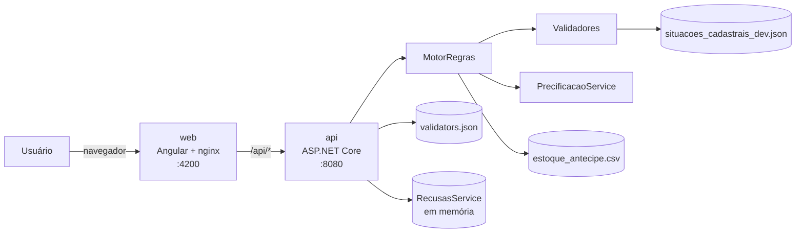

# Antecipe

Portal de antecipação de recebíveis criado para o hackathon Kanastra.

Uma pequena empresa vendeu a prazo e quer o dinheiro hoje. Para isso, ela "vende" suas notas (duplicatas) a um fundo de investimento (FIDC), mas o fundo só pode comprar as notas que cumprem as regras dele: prazo máximo, valor mínimo, sacado com CNPJ ativo, concentração máxima por sacado etc.

No Antecipe, a empresa envia um CSV com as notas e vê:

- **quais notas podem ser antecipadas** (aprovadas ou recusadas, nota a nota);
- **quanto vai receber** (valor de face menos o desconto da antecipação);
- **por que algumas foram recusadas**, em linguagem simples e com o que fazer para resolver.

As regras do fundo ficam em um arquivo JSON que o gestor altera sem novo deploy.

---

## Sumário

1. [Início rápido](#início-rápido)
2. [Estrutura do repositório](#estrutura-do-repositório)
3. [Arquitetura](#arquitetura)
4. [Como executar](#como-executar)
5. [Variáveis de ambiente](#variáveis-de-ambiente)
6. [Formato do CSV](#formato-do-csv)
7. [Regras de validação](#regras-de-validação)
8. [Precificação](#precificação)
9. [API](#api)
10. [Front-end](#front-end)
11. [Testes e validação](#testes-e-validação)
12. [Solução de problemas](#solução-de-problemas)
13. [Documentação complementar](#documentação-complementar)

---

## Início rápido

Com Docker instalado, na raiz do repositório:

```bash
docker compose up --build
```

| O quê | Endereço |
|---|---|
| Portal (front) | http://localhost:4200 |
| API (Swagger) | http://localhost:8080/swagger |

Para experimentar: abra **Nova antecipação**, clique em **Baixar CSV de exemplo**, envie o arquivo baixado e veja o resultado. O exemplo tem 12 notas aprovadas e 7 recusadas, uma por motivo.

---

## Estrutura do repositório

```
.
├── api/                              Back-end (.NET 10)
│   ├── Antecipe.sln
│   ├── Dockerfile
│   ├── Antecipe.Api/                 API ASP.NET Core
│   │   ├── Controllers/              NotasController (rotas /api/notas)
│   │   ├── Application/              MotorRegras, validadores, configuração, precificação
│   │   ├── Domain/                   Modelos (Recebivel, ResultadoLote, Motivo...)
│   │   ├── Infrastructure/           Leitura/escrita de CSV, estoque, recusadas em memória
│   │   ├── Dados/                    Configuração e bases usadas em tempo de execução
│   │   │   ├── validators.json           regras do fundo e precificação
│   │   │   ├── estoque_antecipe.csv      carteira já adquirida pelo fundo
│   │   │   └── situacoes_cadastrais_dev.json  situação cadastral dos sacados (simulada)
│   │   └── Program.cs
│   └── Antecipe.Api.Tests/           Testes xUnit
├── web/                              Front-end (Angular)
│   ├── Dockerfile                    Build Angular + nginx
│   ├── nginx.conf                    Serve o front e repassa /api para a API
│   ├── proxy.conf.mjs                Proxy do ng serve (/api → API local)
│   ├── public/modelo/notas_exemplo.csv
│   ├── e2e/                          Teste ponta a ponta no navegador
│   └── src/app/                      Código da aplicação
├── docs/
│   ├── hackathon/                    Edital e página do dataset do hackathon
│   ├── prompts.md                    Prompts principais usados no projeto (revisados)
│   └── historico-prompts.md          Registro literal dos prompts
└── compose.yaml                      Sobe api + web
```

---

## Arquitetura



- **web:** o Angular lê e valida o formato do CSV no navegador (prévia e erros com a linha exata), envia o arquivo à API e apresenta o resultado. Em produção, o nginx serve os arquivos estáticos e repassa `/api` para a API. Por isso a API não precisa de CORS.
- **api:** recebe o CSV, aplica os validadores ativos de `validators.json` a cada linha, calcula o valor líquido das aprovadas e devolve o resultado do lote. A análise é uma **simulação**: nada é gravado no estoque.
- **Dados:** `validators.json` é relido a cada análise (o gestor altera as regras sem deploy). O estoque e a base de situação cadastral são carregados na inicialização.

---

## Como executar

O projeto roda inteiro pelo Docker. Não é preciso instalar .NET nem Node: as imagens compilam a API e o front.

**Pré-requisito:** Docker com Compose v2 (Docker Desktop no macOS e no Windows).

**1. Clone o repositório e entre na pasta:**

```bash
git clone <url-do-repositório> Antecipe-kanastra
cd Antecipe-kanastra
```

**2. Suba a API e o front:**

```bash
docker compose up --build
```

O primeiro build baixa as dependências do NuGet e do npm e leva alguns minutos. Quando os dois serviços estiverem no ar:

| O quê | Endereço |
|---|---|
| Portal (front) | http://localhost:4200 |
| API (Swagger) | http://localhost:8080/swagger |

**3. Comandos do dia a dia:**

```bash
docker compose up -d --build     # sobe em segundo plano
docker compose ps                # mostra o estado dos serviços
docker compose logs -f api       # acompanha os logs da API (ou: web)
docker compose up -d --build api # rebuilda só a API depois de alterar o código
docker compose down              # derruba tudo
```

**Portas ocupadas?** Escolha outras: `WEB_PORT=3000 API_PORT=9090 docker compose up --build`.

---

## Variáveis de ambiente

Nenhuma é obrigatória: sem elas, o projeto roda com os valores padrão abaixo.

### API (`api/`)

| Variável | Padrão | Uso |
|---|---|---|
| `ANTECIPE_CONFIG` | `Antecipe.Api/Dados/validators.json` | Caminho do JSON com as regras do fundo e a precificação. É relido a cada análise. |
| `ANTECIPE_ESTOQUE` | `Antecipe.Api/Dados/estoque_antecipe.csv` | CSV da carteira já adquirida. Entra na checagem de duplicidade (nota já comprada) e na carteira projetada da concentração. **Não aponte para um arquivo que você vá enviar para análise**: todas as notas dele seriam recusadas como já existentes na carteira. |
| `ANTECIPE_SITUACOES` | `Antecipe.Api/Dados/situacoes_cadastrais_dev.json` | Situação cadastral de cada CNPJ de sacado (`{"58206002000111": "ATIVA", ...}`). Sacados ausentes ficam `PENDENTE_VALIDACAO`. |
| `ASPNETCORE_URLS` | `http://localhost:5000` no `dotnet run`; porta `8080` no container | Endereço em que a API escuta. Equivale a `--urls`. |
| `ASPNETCORE_ENVIRONMENT` | `Production` | Use `Development` para ver detalhes de erro. |
| `TZ` | `America/Sao_Paulo` no `compose.yaml` | Fuso dos logs. As regras não dependem dele: usam a `DATA_AQUISICAO` de cada nota. |

No Docker, os arquivos ficam em `/app/Dados/`. Para trocar as regras sem rebuild, monte um volume e aponte a variável para ele:

```yaml
# compose.yaml, serviço api
    volumes:
      - ./minhas-regras.json:/config/validators.json:ro
    environment:
      ANTECIPE_CONFIG: /config/validators.json
```

### Front (`web/`)

| Variável | Padrão | Uso |
|---|---|---|
| `ANTECIPE_API_URL` | `http://localhost:5000` | Usada só pelo `npm start` (`proxy.conf.mjs`): destino das chamadas `/api`. Ex.: `ANTECIPE_API_URL=http://localhost:5080 npm start` (PowerShell: `$env:ANTECIPE_API_URL="http://localhost:5080"; npm start`). |

O `apiBaseUrl` de `src/environments/environment*.ts` é definido no build, não é variável de ambiente. Ele fica vazio porque o front chama `/api` na mesma origem: no `npm start` via proxy, e no Docker via nginx.

### Docker Compose (`compose.yaml`)

| Variável | Padrão | Uso |
|---|---|---|
| `API_PORT` | `8080` | Porta do host publicada para a API |
| `WEB_PORT` | `4200` | Porta do host publicada para o front |

---

## Formato do CSV

- Codificação **UTF-8**, separador **`;`**, campos opcionalmente entre aspas.
- Cabeçalho obrigatório, exatamente nesta ordem:

```
NOME_FUNDO;DOC_FUNDO;NOME_CEDENTE;DOC_CEDENTE;NOME_SACADO;DOC_SACADO;NU_DOCUMENTO;TIPO_RECEBIVEL;VALOR_NOMINAL;DATA_VENCIMENTO_ORIGINAL;DATA_AQUISICAO
ANTECIPE FIDC;92.234.400/0001-80;Atelier Ipê Móveis;11.111.111/0001-91;Mercado Serra Azul;58.206.002/0001-11;NF-1001;Duplicata;1250,00;15/01/2027;24/10/2026
```

| Coluna | Conteúdo |
|---|---|
| `NOME_FUNDO` / `DOC_FUNDO` | Fundo que compra a nota (CNPJ com ou sem máscara) |
| `NOME_CEDENTE` / `DOC_CEDENTE` | Empresa que vende a nota |
| `NOME_SACADO` / `DOC_SACADO` | Empresa que vai pagar a nota |
| `NU_DOCUMENTO` | Número do documento. Parcelas podem repetir o número com vencimentos diferentes. |
| `TIPO_RECEBIVEL` | Ex.: `Duplicata`, `Duplicata de Serviço`, `Cheque`, `CCB` |
| `VALOR_NOMINAL` | Vírgula decimal, **sem** separador de milhar (`4250,00`). Maior que zero. |
| `DATA_VENCIMENTO_ORIGINAL` / `DATA_AQUISICAO` | `dd/mm/aaaa` |

Uma linha com valor, data, número de documento ou quantidade de colunas inválidos **não interrompe o lote**: ela volta como `RECUSADA` com o motivo `FORMATO_INVALIDO`. Só um arquivo ausente, vazio ou com cabeçalho inválido gera HTTP 400. O limite de tamanho é de cerca de 30 MB, o padrão do Kestrel e o mesmo configurado no nginx.

---

## Regras de validação

As regras ficam em `api/Antecipe.Api/Dados/validators.json`:

```jsonc
{
  "fundo": { "nome": "ANTECIPE FIDC", "cnpj": "92.234.400/0001-80" },
  "validadores": [
    { "codigo": "PRAZO_MAXIMO", "ativo": true, "parametros": { "prazo_maximo_dias": 180 } }
    // ...
  ],
  "precificacao": { "metodo": "DESCONTO_SIMPLES", "taxa_mensal_percentual": 2.0, "base_dias": 30 }
}
```

Só os validadores com `"ativo": true` são aplicados, na ordem do arquivo, e **todos** os motivos de recusa são devolvidos, não só o primeiro. Uma configuração inválida (código desconhecido ativo, parâmetro ausente ou fora da faixa) faz a análise responder HTTP 500 com a explicação.

| Código | Parâmetros | Recusa quando |
|---|---|---|
| `CNPJ_SACADO_VALIDO` | (nenhum) | Os dígitos verificadores do CNPJ do sacado não conferem |
| `SITUACAO_CADASTRAL_SACADO` | `situacoes_aceitas` (lista) | A situação do sacado na base não está na lista. Se o CNPJ não está na base, a nota fica **pendente**. |
| `TIPO_RECEBIVEL` | `tipos_aceitos` (lista) | O tipo não está na lista |
| `VALOR_MINIMO` | `valor_minimo` | Valor nominal abaixo do mínimo |
| `NAO_VENCIDA` | (nenhum) | Vencimento anterior à `DATA_AQUISICAO` |
| `PRAZO_MAXIMO` | `prazo_maximo_dias` | Dias entre a `DATA_AQUISICAO` e o vencimento acima do máximo |
| `PRAZO_MINIMO` | `prazo_minimo_dias` | Dias entre a `DATA_AQUISICAO` e o vencimento abaixo do mínimo |
| `CONCENTRACAO_MAXIMA_SACADO` | `percentual_maximo`, `agrupamento: "RAIZ_CNPJ"` | A raiz do CNPJ do sacado (8 primeiros dígitos) passa do percentual da carteira projetada do fundo |
| `CONCENTRACAO_MAXIMA_CEDENTE` | `percentual_maximo` | O CNPJ do cedente passa do percentual da carteira projetada do fundo |

Além dos validadores configuráveis, a API sempre aplica:

| Código | Quando |
|---|---|
| `FORMATO_INVALIDO` | A linha não pôde ser lida (valor, data, colunas, documento vazio) |
| `RECEBIVEL_DUPLICADO` | A nota já está no estoque, ou aparece mais de uma vez no lote |
| `PRECIFICACAO_INVALIDA` | O desconto ficaria maior que o valor da nota (a nota fica pendente) |

### Detalhes importantes

- **Data de referência:** é a `DATA_AQUISICAO` da nota, não a data do servidor. Ela vale para vencimento, prazos e desconto.
- **Concentração:** a carteira projetada de um fundo é o estoque desse fundo somado a **todas** as notas do lote desse fundo. O cálculo não depende da ordem das linhas, e a regra só é avaliada para notas que passaram nas demais.
- **Fundo:** cada nota é avaliada contra a carteira do próprio fundo informado no CSV. As regras de `validators.json` valem para todos os fundos do arquivo.
- **Duplicidade:** a chave é fundo + cedente + número do documento + vencimento. Parcelas de um mesmo documento não são duplicatas. Repetições dentro do arquivo saem do lote (a primeira ocorrência é mantida) e voltam na lista `duplicadas`.
- **Status final:**
  - `RECUSADA` se alguma regra recusou a nota, mesmo que outra verificação esteja indisponível;
  - `PENDENTE_VALIDACAO` se nada recusou, mas alguma verificação não pôde ser concluída;
  - `APROVADA` nos demais casos.

### Validação contra o dataset oficial

O arquivo `estoque_antecipe.csv` do dataset do hackathon (100.554 linhas, 18 fundos) tem um resultado oficial, `resultado_esperado_100k.json`. Enviado para `POST /api/notas/analisar`, o resultado da API é idêntico ao oficial em todas as linhas: mesmo status, mesmo `id` e os mesmos códigos em `barrado_por`, na mesma ordem. São 85.215 aprovadas e 15.339 barradas.

> A base `situacoes_cadastrais_dev.json` é simulada: o dataset não traz a situação cadastral dos sacados. Ela lista os 4.209 sacados do dataset; os 87 barrados no resultado oficial aparecem como `BAIXADA` e os demais como `ATIVA`. Em produção, ela seria substituída por uma consulta à Receita Federal (interface `ISituacaoCadastralProvider`).

---

## Precificação

Desconto simples, proporcional aos dias até o vencimento:

```
dias          = DATA_VENCIMENTO_ORIGINAL − DATA_AQUISICAO
desconto      = valor_nominal × (taxa_mensal_percentual / 100) × dias / base_dias
valor_líquido = arredonda(valor_nominal − desconto, 2 casas)
```

Exemplo, com taxa de 2% ao mês e base de 30 dias: uma nota de R$ 1.250,00 com 83 dias até o vencimento tem desconto de R$ 69,17 e valor líquido de **R$ 1.180,83**.

---

## API

Swagger UI em `/swagger` e OpenAPI em `/openapi/v1.json`. Não há autenticação.

### `POST /api/notas/analisar`

Simula a antecipação de um lote. Recebe `multipart/form-data` com o CSV no campo **`arquivo`**.

```bash
curl -F "arquivo=@web/public/modelo/notas_exemplo.csv" http://localhost:8080/api/notas/analisar
```

Resposta **200** (resumida):

```jsonc
{
  "totalRecebiveis": 19,
  "quantidadeAprovada": 12,
  "quantidadeRecusada": 7,
  "quantidadePendente": 0,
  "valorTotalLiquido": 15743.40,
  "resultados": [
    {
      "linha": 2, "numeroDocumento": "NF-1001", "status": "APROVADA",
      "valorNominal": 1250.00, "valorLiquido": 1180.83, "motivos": [],
      "dados": { "NOME_SACADO": "MARÍLIA CAMA, MESA E BANHO LTDA", "...": "..." }
    },
    {
      "linha": 19, "numeroDocumento": "NF-1018", "status": "RECUSADA",
      "valorNominal": 2300.00, "valorLiquido": null,
      "motivos": [{
        "codigo": "SITUACAO_CADASTRAL_SACADO",
        "mensagem": "A empresa sacada está com situação cadastral BAIXADA na Receita Federal. O fundo só aceita sacados com situação: ATIVA."
      }],
      "dados": { "...": "..." }
    }
  ],
  "aceitas": [ /* subconjunto de resultados com status APROVADA */ ],
  "recusadas": [ /* subconjunto de resultados com status RECUSADA */ ],
  "duplicadas": [ /* { linha, linhaOriginal, numeroDocumento, dados, mensagem } */ ],
  "loteId": "518a2338-6229-49f0-8cf1-9b31032051d3",
  "perguntaDownload": "7 notas foram recusadas. Deseja baixar o arquivo CSV apenas com as 12 notas aprovadas?",
  "csvSemRecusadas": "NOME_FUNDO;DOC_FUNDO;...\r\nANTECIPE FIDC;..."
}
```

| Campo | Descrição |
|---|---|
| `resultados` | Uma entrada por linha analisada, em ordem de linha. `linha` é a linha no CSV (cabeçalho = 1) e `dados` traz os valores originais. |
| `status` | `APROVADA`, `RECUSADA` ou `PENDENTE_VALIDACAO` |
| `valorLiquido` | Só para aprovadas |
| `motivos` | Todas as regras não atendidas, com `codigo` e `mensagem` em linguagem simples |
| `duplicadas` | Linhas repetidas que ficaram fora da análise |
| `loteId` | Identifica o lote. As recusadas ficam guardadas em memória. |
| `perguntaDownload` / `csvSemRecusadas` | Presentes quando houve recusadas ou duplicadas e sobrou ao menos uma aprovada: a pergunta para o usuário e o CSV só com as aprovadas |

Outras respostas:

| HTTP | Quando | Corpo |
|---|---|---|
| 400 | Arquivo ausente ou vazio, cabeçalho inválido, CSV sem notas | `{ "erro": "..." }` |
| 500 | `validators.json` inválido | `ProblemDetails` com `detail: "Configuração de regras inválida: ..."` |

### `GET /api/notas/lotes/{loteId}/recusadas`

Devolve as notas recusadas de um lote já analisado: arquivo, data da análise, linha, número do documento, valor, dados originais e motivos. A API guarda os 200 lotes mais recentes, e o histórico se perde quando ela reinicia. Lote inexistente ou expirado: **404**.

---

## Front-end

Angular 22 (standalone, signals, zoneless), TypeScript strict, SCSS com design system próprio, ícones Lucide.

| Tela | O que faz |
|---|---|
| **Visão geral** (`/`) | Resumo da última análise: valor disponível, aprovadas, recusadas, elegibilidade e principais motivos |
| **Nova antecipação** (`/nova-antecipacao`) | Upload por arrastar e soltar ou seleção, CSV de exemplo, prévia das linhas e validação de formato com a linha exata |
| **Análise** (`/analise`) | Valor a receber e como ele foi calculado, aprovadas, recusadas, motivos agrupados, tabela de notas e download |

Na tela **Análise**:

- **Download só das aprovadas:** quando há recusadas ou duplicadas, um card pergunta se o usuário quer baixar o CSV só com as aprovadas. A lista de duplicadas pode ser aberta no próprio card, e o botão fica também no cabeçalho.
- **Tabela de notas:** busca por documento, sacado ou CNPJ; filtros por status e motivo (sincronizados com a URL); ordenação; paginação; e um campo expansível em cada recusada com todos os motivos e o que fazer.
- **Painel de detalhes:** explicação completa de cada nota, com navegação anterior/próxima.
- **Exportar resultado:** baixa o resultado completo em CSV.

O front não aplica regras de elegibilidade. Tudo vem da API, e a validação local é só de formato. Detalhes em [`web/README.md`](web/README.md), [`web/API_INTEGRATION.md`](web/API_INTEGRATION.md) e [`web/DESIGN_SYSTEM.md`](web/DESIGN_SYSTEM.md).

---

## Testes e validação

```bash
# API: testes xUnit (regras, CSV, motor, precificação, configuração)
dotnet test api/Antecipe.sln

# Front: testes unitários e de componente (Vitest)
cd web && npm run test:ci

# Front: build de produção
cd web && npm run build

# Ponta a ponta no navegador: exige a API em :5000 e o npm start em :4200 no ar
cd web && npm run e2e
```

Para conferir as regras contra o dataset oficial, envie o `estoque_antecipe.csv` de 100 mil linhas para `POST /api/notas/analisar` e compare `resultados[].status` e `resultados[].motivos[].codigo` com o `resultado_esperado_100k.json`. A análise leva cerca de 10 segundos e a resposta tem cerca de 130 MB.

---

## Solução de problemas

| Sintoma | Causa e solução |
|---|---|
| `The Angular CLI requires a minimum Node.js version...` | Node antigo. Instale 24.15+ (`nvm install 24` ou `brew upgrade node`). |
| `Cannot find module '.../node_modules/piscina/dist/main.js'` ou outro `MODULE_NOT_FOUND` | Instalação do npm interrompida ou corrompida. Rode `npm ci` em `web/`. |
| `localhost:4200` mostra um front antigo ou dá erro 500 no `/api` | Outro processo (um `ng serve` antigo, por exemplo) está ocupando a porta 4200. Encerre-o, ou suba o Docker com `WEB_PORT=4300`. |
| Front local sem resposta da API | A API precisa estar em `http://localhost:5000`, ou defina `ANTECIPE_API_URL`. |
| Todas as notas recusadas por `CONCENTRACAO_MAXIMA_SACADO` | Lote pequeno com poucos sacados: cada um passa de 10% da carteira projetada. É o comportamento esperado. Use mais sacados ou um estoque maior. |
| Todas as notas recusadas por `RECEBIVEL_DUPLICADO` | `ANTECIPE_ESTOQUE` aponta para o próprio arquivo enviado. |
| Notas `PENDENTE_VALIDACAO` por situação cadastral | O CNPJ do sacado não está em `situacoes_cadastrais_dev.json`. Inclua-o no arquivo. |
| "Não foi possível guardar este resultado no navegador" | Resultado grande demais para o `localStorage`. A análise funciona, mas se perde ao recarregar a página. |
| HTTP 413 ou falha no upload | Arquivo acima de cerca de 30 MB |

---

## Documentação complementar

| Documento | Conteúdo |
|---|---|
| [`api/README.md`](api/README.md) | Desenvolvimento da API |
| [`web/README.md`](web/README.md) | Desenvolvimento do front, scripts e estrutura |
| [`web/API_INTEGRATION.md`](web/API_INTEGRATION.md) | Contrato da API e como o front o consome |
| [`web/DESIGN_SYSTEM.md`](web/DESIGN_SYSTEM.md) | Tokens, tipografia e princípios visuais |
| [`docs/prompts.md`](docs/prompts.md) | Prompts principais usados para construir o projeto |
| [`docs/historico-prompts.md`](docs/historico-prompts.md) | Registro literal dos prompts |
| [`docs/hackathon/`](docs/hackathon/) | Edital e página do dataset do hackathon |
